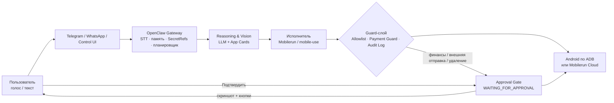

# План работы: Hands-Free Phone Agent

> Источник требований: [prd_mobile_ai_assistant.md](../prd_mobile_ai_assistant.md) (PRD v1.0, 15.10.2026)
> Трекер прогресса: [PROGRESS.md](PROGRESS.md)

## 1. Цель

Создать мультимодального ИИ-агента, который по голосовой или текстовой команде на русском, казахском или английском управляет реальными мобильными приложениями (Android → iOS) через графический интерфейс: нажимает, листает, читает экран, вводит текст. Принцип безопасности — **«Prepare & Approve»**: агент готовит действие, человек подтверждает оплату, переводы и важные отправки.

Срок: **10 недель**, три последовательные фазы — от бесплатного локального MVP (Windows + Android) до облачного продукта 24/7 (Android + iOS).

## 2. Объём: сценарии по фазам

| Сценарий | Приложения | Фаза 1 (MVP) | Фаза 2 | Фаза 3 |
| :--- | :--- | :--- | :--- | :--- |
| 1. Переписки и мессенджеры | WhatsApp, Telegram, Instagram Direct, Gmail | ✅ WhatsApp, Telegram | Правила черновиков для новых/деловых чатов | Утренняя сводка 08:30, iOS |
| 2. Бронирование столиков | 2ГИС, Яндекс Карты, Instagram, WhatsApp-боты, Choco | Поиск в 2ГИС | ✅ Полный сценарий брони | Облако, iOS |
| 3. Доставка еды и продуктов | Яндекс Еда / Go, Wolt, Glovo, Chocofood, Arbuz.kz | ✅ Корзина до чекаута | Память «мой обычный заказ», App Cards | Replay Macros, OTP |
| 4. Билеты (авиа, ж/д, кино) | Aviata, Kaspi Travel, Freedom Travel, Ticketon, Яндекс Афиша | — | ✅ До Approval Gate, профили пассажиров | Мониторинг статуса рейса |

## 3. Архитектура

Три независимых слоя со стандартными протоколами обмена:

| Слой | Компоненты | Вводится |
| :--- | :--- | :--- |
| **1. Gateway & Memory** | OpenClaw (рантайм, каналы Telegram/WhatsApp, Control UI), долгосрочная память, SecretRefs, планировщик, STT/TTS (Whisper / Deepgram) | Ф1: простой Telegram-бот/CLI → Ф2: OpenClaw, голос, память → Ф3: сервер 24/7, расписания |
| **2. Mobile GUI Execution** | Mobilerun Framework + Portal APK (ADB USB/Wi-Fi), mobile-use (структурированный сбор), Mobilerun Cloud (Android + iPhone) | Ф1: Mobilerun локально → Ф2: mobile-use → Ф3: Mobilerun Cloud |
| **3. Reasoning & Vision** | Гибрид A11y-tree + `--vision`, единый конфигуратор LLM (Claude, GPT, Gemini, Grok, UI-TARS, AutoGLM), App Cards | Ф1: гибрид + конфигуратор → Ф2: App Cards → Ф3: Replay Macros |



## 4. Технологический стек

- **Язык:** Python 3.11+.
- **Управление устройством:** Android platform-tools (ADB), Mobilerun Framework, Mobilerun Portal (Accessibility Service), mobile-use (Minitap AI), Mobilerun Cloud API.
- **Шлюз и каналы:** OpenClaw, Telegram Bot API, опционально WhatsApp.
- **Голос:** Whisper API / Deepgram, опционально голосовой модуль OpenClaw Android Node.
- **Модели:** Claude, OpenAI GPT, Gemini, Grok; открытые GUI-модели UI-TARS-1.5, AutoGLM-Phone-9B — через единый конфигуратор.
- **Хранилища:** локальное зашифрованное хранилище секретов, память профиля, журнал траектории (файлы/SQLite на MVP).

## 5. Структура репозитория (ориентир)

```
keremet-ai/
├── agent/          # ядро: CLI, цикл агента, конфигуратор LLM, телеметрия
├── devices/        # DeviceProvider: local_adb, cloud_android, cloud_ios
├── security/       # allowlist, payment guard, approval gate, secret refs, audit log
├── gateway/        # интеграция OpenClaw, Telegram-бот, STT/TTS
├── memory/         # профиль пользователя, пассажиры, частые заказы
├── app_cards/      # шаблоны навигации по приложениям (YAML/MD)
├── macros/         # Replay Macros
├── scheduler/      # проактивные задачи
├── tests/scenarios/# повторяемые сценарии и KPI-прогоны
└── docs/           # эта документация
```

Структура — ориентир; финальное решение фиксируется в журнале решений [PROGRESS.md](PROGRESS.md#6-журнал-решений).

## 6. Сквозные требования безопасности

Действуют во всех фазах; первая реализация указана в скобках.

1. **Prepare & Approve / Payment Guard** — безусловная остановка перед «Оплатить / Купить / Перевести» со скриншотом пользователю (P1-11).
2. **App Allowlist** — агент открывает только разрешённые приложения; системные настройки безопасности и приложения вне списка блокируются на уровне драйвера (P1-09).
3. **Audit Log** — каждый клик и скриншот сохраняются в локальном журнале траектории (P1-10, облако — P3-13).
4. **Approval Gate** — действия категорий «Финансы», «Отправка внешним адресатам», «Удаление данных» переводят сессию в `WAITING_FOR_APPROVAL` с кнопками «Подтвердить» / «Отменить» (P2-07…P2-09).
5. **SecretRefs** — пароли, паспортные данные, номера карт, OTP никогда не попадают в контекст облачной LLM; подстановка локально на уровне исполнителя (P2-11, P2-12, P3-06).
6. **Оплата без банковских приложений** — привязанные карты внутри агрегаторов; для Kaspi — «Выставить счёт» с подтверждением пользователем через пуш (P2-19).
7. **Won't Have** — никакого root/jailbreak, обхода FLAG_SECURE и хранения банковских PIN в промптах (проверяется в P3-14).

## 7. Дорожная карта

| Фаза | Сроки | Фокус | DoD | Детали |
| :--- | :--- | :--- | :--- | :--- |
| **1. MVP** | Недели 1–3 | Локальный запуск Windows + Android, Must Have | Успешное выполнение команды из терминала Windows на реальном Android-телефоне | [phase-1-mvp.md](phases/phase-1-mvp.md) |
| **2. Оркестрация** | Недели 4–6 | OpenClaw, голос, память, App Cards, Approval Gate, Should Have | Задача голосом через Telegram-бота → скриншот чекаута на одобрение | [phase-2-orchestration.md](phases/phase-2-orchestration.md) |
| **3. Cloud 24/7** | Недели 7–10 | Mobilerun Cloud, iOS, OTP, расписания, Replay Macros, Could Have | Задачи 24/7 при выключенном ноутбуке на Android и iOS | [phase-3-cloud.md](phases/phase-3-cloud.md) |

Переход к следующей фазе — только после выполнения DoD текущей и отметки в [PROGRESS.md](PROGRESS.md).

## 8. KPI и способ измерения

| Метрика | Цель (PRD) | Как измеряем | Первый замер |
| :--- | :--- | :--- | :--- |
| Task Success Rate | ≥ 85% на типовых сценариях с App Cards | Регресс-набор сценариев, доля задач, дошедших до ожидаемого результата | P1-17 (baseline), P2-20, P3-15 |
| End-to-End Latency | 25–45 с для 5–8 шагов; ≤ 90 с для сложных | Телеметрия задачи (P1-08), медиана и p90 | P1-17 |
| Cost per Task | $0.03–$0.08 | Сумма токенов × тариф модели по телеметрии | P1-17 |
| Zero Unauthorized Spend | 100% перехват платёжных экранов | Тесты чекаута во всех сценариях, аудит журнала | P1-11, P3-14 |

## 9. Риски и митигации

| Риск | Вероятность / влияние | Митигация |
| :--- | :--- | :--- |
| Антифрод-детекция ADB (Appdome RASP) в банковских и билетных приложениях | Высокая / высокое | Не работать в банковских приложениях; Kaspi — invoice-сценарий; список несовместимых приложений |
| FLAG_SECURE — чёрные скриншоты | Высокая / среднее | Работа по A11y-дереву; обход запрещён (Won't Have) |
| Изменения UI приложений ломают сценарии | Высокая / среднее | App Cards с версионированием, валидация экрана, fallback на vision |
| Качество STT для казахского и смешанного ввода | Средняя / среднее | Сравнение провайдеров, словарь топонимов, подтверждение распознанной команды |
| Перерасход на vision-режиме | Средняя / среднее | Vision по триггеру, телеметрия стоимости, Replay Macros |
| Утечка персональных данных в LLM | Низкая / критичное | SecretRefs, автотесты на утечку, Audit Log |
| Доступность и цена облачных iPhone | Средняя / среднее | Ранний пилот на одном устройстве в фазе 3 |
| Блокировка аккаунтов при переносе в облако | Средняя / высокое | Резидентский IP, постепенный перенос, тестовые аккаунты |

## 10. Допущения и открытые вопросы

- Разработку ведёт небольшая команда (1–2 человека); оценки сроков взяты из PRD.
- На MVP используется один тестовый Android-телефон с зафиксированными версиями приложений.
- Нужно выбрать основную LLM для MVP по результатам baseline (стоимость vs успех).
- Нужно уточнить тарифы Mobilerun Cloud и доступность физических iPhone до начала фазы 3.
- Хранение реальных паспортных данных — только после реализации SecretRefs (P2-11).
